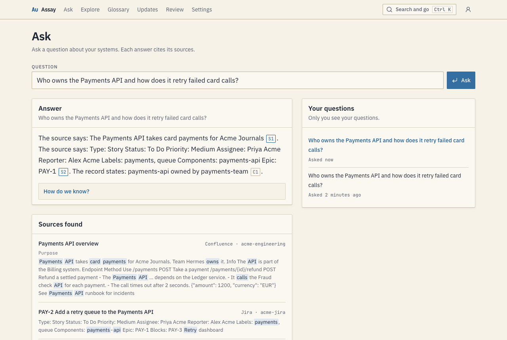
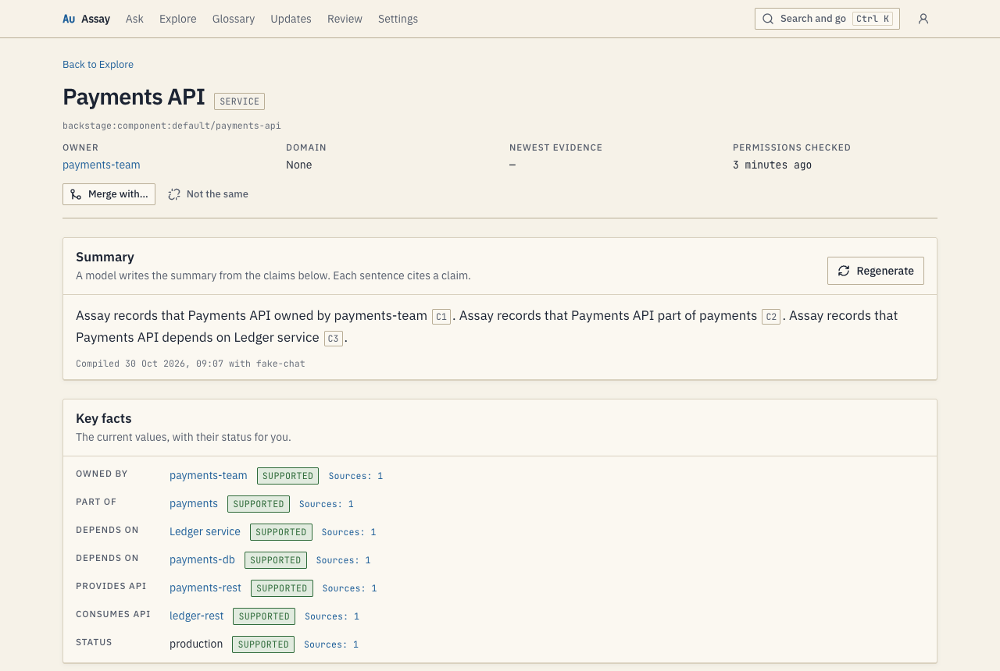
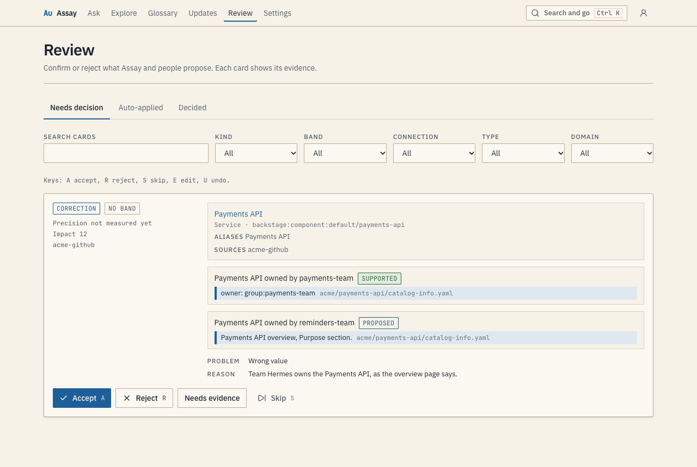

# Assay

Assay is a self-hosted company intelligence platform. It connects the knowledge in your business and technical systems, such as Jira, Confluence, GitHub and Azure DevOps Server. Each fact links to the source passage that supports it.

People use the web app: they ask questions, read knowledge pages and review what Assay proposes. AI agents use MCP and REST with the permissions of their user. Assay never shows content from a source that the reader cannot read.



## Install

You need Docker Desktop. Run this command:

```sh
curl -fsSL https://github.com/alternayte/assay/releases/latest/download/install.sh | sh
```

The script installs Assay in `~/.assay`, starts it on `http://localhost:8080` and prints a setup token. Open `http://localhost:8080/setup` and create the first admin with the token.

To try Assay with the synthetic Acme data and no real source, add `--demo`:

```sh
curl -fsSL https://github.com/alternayte/assay/releases/latest/download/install.sh | sh -s -- --demo
```

After setup, Assay creates the Acme connections and syncs them. To get answers and page summaries, turn on the models in Settings, Models. [docs/install.md](docs/install.md) has the flags, updates, backups and the corporate proxy settings.

## What Assay does

- **Connections** read Jira and Confluence Data Center, GitHub and Azure DevOps Server. They are read-only: Assay sends only GET and HEAD requests.
- **Ask** answers a question from the sources and the claims, with a citation for each sentence. A drawer shows the passage of each citation.
- **Knowledge pages** show each entity (a service, a team, a person, an initiative, a term) with key facts, conflicts, decisions, a timeline and sources.
- **Claims** are facts with evidence. Each claim has a status for the reader: Supported, Conflicting, Stale, Superseded or Proposed.
- **Glossary** holds the approved terms, their synonyms and their owners. Terms in answers and pages show a popover with the definition.
- **Review** is the queue where reviewers confirm what Assay proposes: merges of duplicates, new terms, reported problems and findings.
- **Updates** lists the recent changes per entity.





## Configuration

Assay reads its configuration from environment variables. `install.sh` writes them to `~/.assay/.env`.

| Variable | Use |
|---|---|
| `ASSAY_DATABASE_URL` | The PostgreSQL URL. The database needs pgvector, pg_trgm and unaccent. |
| `ASSAY_SECRET_KEY` | 32 random bytes in base64. They encrypt the stored source tokens and model keys. Keep a copy. |
| `ASSAY_BASE_URL` | The public URL of the instance. |
| `ASSAY_SETUP_TOKEN` | The token for the first setup. |
| `ASSAY_ROLE` | `all` (default), `web` or `worker`. |
| `ASSAY_DEMO` | `true` creates the Acme demo connections after setup. |
| `HTTP_PROXY`, `HTTPS_PROXY`, `NO_PROXY` | A corporate proxy. |
| `ASSAY_EXTRA_CA_PEM`, `ASSAY_EXTRA_CA_FILE` | Extra CA certificates for a proxy with TLS inspection. |
| `ASSAY_LOG_LEVEL` | `debug`, `info` (default), `warn` or `error`. |

Admins set everything else in the UI: connections, visibility groups, domains, model endpoints and budgets, decision bands, source priority, connector rules, lint thresholds, retention, SMTP, users and roles. `assay doctor` checks the database, the secret key, the proxy, the CA certificates and each endpoint.

## Security model

- Each connection is visible to its owner and to the groups that an admin shares it with. A user reads only the content of the connections in their visible set. No role, token or setting goes around this rule, admins included.
- Counts, statuses, conflicts and traversals come from the visible evidence of the reader only. A hidden object and a missing object give the same answer.
- Source tokens and model keys are encrypted at rest. Access, invite and reset tokens are stored as hashes and show once.
- The audit log records settings, connection, visibility, user, role, token, review, merge and registry actions and MCP calls. No route changes it.

[docs/security.md](docs/security.md) has the details.

## Connect an agent

Create an access token in Access tokens. Select `read`, and `propose` if the agent sends findings to review. Then add Assay to your MCP client:

```json
{
  "mcpServers": {
    "assay": {
      "type": "http",
      "url": "http://localhost:8080/mcp",
      "headers": { "Authorization": "Bearer YOUR_TOKEN" }
    }
  }
}
```

The Connect an agent page shows this configuration with the URL of your instance. The agent reads with your permissions. [docs/mcp.md](docs/mcp.md) lists the tools. The REST reference is at `/api/docs`.

## Development

You need Go (the version in `go.mod`), Bun, just and Docker.

```sh
just setup     # pinned tools and web packages
just dev       # build the web app and run the server; needs ASSAY_DATABASE_URL and ASSAY_SECRET_KEY
just test      # unit and integration tests with PostgreSQL in testcontainers
just ci        # the full gate: generated code, format, lint, tests, contract, browser, smoke, bench
```

`go run ./cmd/assay help` lists the operator commands. `assay fixtures serve` starts the fake Acme sources and the fake model API that the tests and the demo use. [AGENTS.md](AGENTS.md) describes the layout and the rules for contributors.

## Licence

MIT. See [LICENSE](LICENSE).
